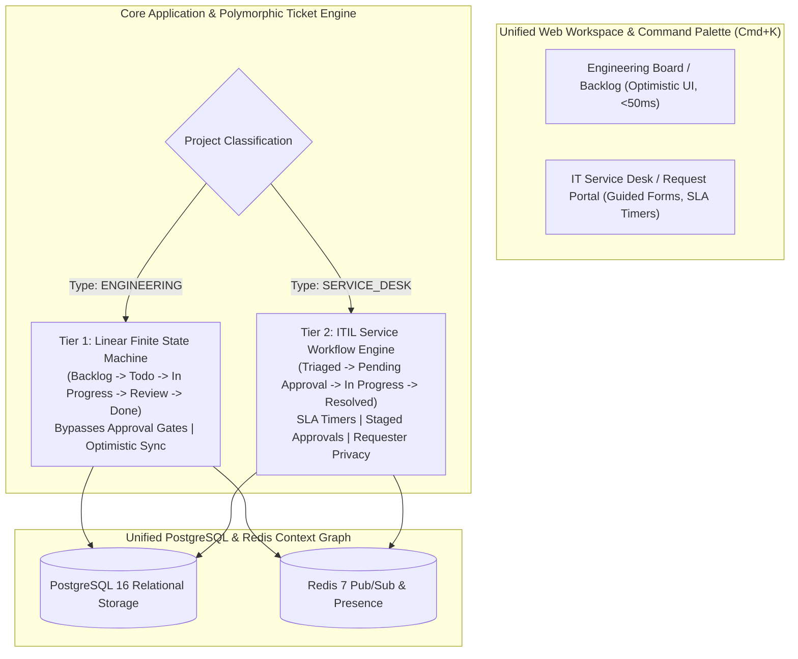

# Phase 2 — Requirement Critique & Architectural Stress-Testing

As a Senior Software Architect and Technical Lead, this document stress-tests the requirements gathered during Phase 1 Discovery, highlights architectural contradictions, pinpoints hidden development cost drivers, and presents concrete simplifications.

---

## 1. Identified Missing Functionality (The "Iceberg" Requirements)

During discovery, product discussions naturally gravitate toward visible UI features (boards, tickets, comments). However, in enterprise ITSM and engineering environments, the following critical capabilities are frequently missed until post-launch emergencies:

| Missing Feature | Why It Is Critical | Architectural Remediation |
| :--- | :--- | :--- |
| **SCIM Deprovisioning & User Deactivation Protocol** | When an employee or contractor leaves the company, IdP deactivates their account via SCIM. What happens to their assigned tickets, active sprint tasks, and pending approvals? Without a cascade handler, tickets become orphaned and approval workflows stall indefinitely. | Implement an automated user deactivation workflow: automatically revoke active sessions in Redis, flag account as `INACTIVE`, unassign or reassign open issues to team leads, and trigger approval escalation timeouts. |
| **Business Hours & Holiday Calendars for SLAs** | SLA timers cannot run $24\times7$ for standard IT tickets (e.g., a ticket opened Friday at 6:00 PM with an 8-hour SLA will breach Saturday at 2:00 AM if business hours aren't modeled). | Introduce a `business_calendars` table supporting departmental working hours (e.g., 9:00 AM – 5:00 PM Mon–Fri) and official corporate holiday blackouts before calculating SLA countdown intervals. |
| **Transactional Outbox for Search & Real-Time Sync** | If a ticket is updated in PostgreSQL and the server crashes before pushing the event to Meilisearch or Redis Pub/Sub, the search index and live user boards will desynchronize permanently. | Implement the **Transactional Outbox Pattern**: every ticket mutation writes an event record to an `outbox_events` table within the same database transaction. A lightweight background worker tails this table and guarantees at-least-once delivery to Meilisearch and Redis. |
| **Bulk Ticket Operations & Multi-Select Triage** | In mid-to-large enterprises, managers and leads need to reassign 50 tickets at once, bulk-transition statuses, or close batches of resolved issues. Without bulk endpoints, users will automate this via scripts, hammering the API with 50 individual sequential requests. | Build native batch endpoints (`/api/v1/tickets/batch-update`) executing atomic set-based SQL updates (`UPDATE tickets SET ... WHERE id IN (...)`) wrapped in a single database transaction. |
| **Out-of-Office & Vacation Delegation for Approvals** | If an IT approval requires a specific manager who is on annual leave for two weeks, procurement and access requests freeze. | Implement an `approval_delegations` table allowing employees to nominate a temporary delegate during specified date windows. |

---

## 2. Identified Unnecessary Complexity & Simplifications

| Over-Engineered Proposal | Architectural Hazard | Approved Simplification |
| :--- | :--- | :--- |
| **Arbitrary Infinite Task Nesting (ClickUp-style)** | Causes recursive database CTE lockups, breaks Kanban board lane rendering, corrupts sprint velocity calculations, and causes optimistic UI race conditions. | **Capped 3–4 Level Hierarchy:** `Initiative` $\rightarrow$ `Epic` $\rightarrow$ `Task/Story/Bug` $\rightarrow$ `Subtask`. Covers 99.8% of agile workflows while ensuring deterministic $O(1)$ query performance and clear visual swimlanes. |
| **Jira-Style Dynamic SQL Permission Schemes** | Joining 5 relational tables (`users` $\rightarrow$ `group_memberships` $\rightarrow$ `project_roles` $\rightarrow$ `permission_schemes` $\rightarrow$ `scheme_attributes`) on every API request and board card is the #1 cause of Jira's notorious latency. | **Pre-Computed 64-Bit Bitmask Permissions:** Permissions are mapped to Project Roles and resolved into a 64-bit integer at session load. Authorization checks execute as instantaneous bitwise operations (`(userBitmask & PERM_FLAG) != 0`). |
| **Day-One Cascading Auto-Shift Gantt Charts** | Automatically shifting start/end dates of 40 downstream dependent tasks on every drag event causes background job write storms, concurrency deadlocks, and silent project schedule drift. | **Interactive Gantt with 'Warning Mode':** Visual dependency arrows and milestone bars are draggable, but dependency violations trigger immediate visual conflict alerts (red badges/banners) rather than uncontrolled cascading date shifts. |

---

## 3. Resolving the Fundamental Contradiction: Linear Velocity vs. Jira ITSM Rigor

During discovery, the requirement arose to achieve **sub-100ms keyboard-driven velocity** (Linear) while simultaneously supporting **enterprise approvals, SLAs, and ITIL workflows** (Jira Service Management).

### The Architectural Synthesis: Two-Tier Project Polymorphism
Rather than forcing all projects into a single bloated state machine or stripping away IT compliance, we enforce a strict architectural bifurcation at the project level:

---

## 4. Potential Scalability Bottlenecks & Mitigations

1. **WebSocket Connection Churn during Enterprise Announcements:**
   * *Risk:* 1,000–3,000 concurrent internal workers opening 5 browser tabs each can create 5,000–15,000 simultaneous persistent WebSocket connections. A single Node.js process will exhaust file descriptors and memory.
   * *Mitigation:* Decouple the WebSocket gateway from the core REST API. Run dedicated stateless WebSocket nodes fronted by an NGINX / AWS ALB load balancer with Redis adapter clustering (`@socket.io/redis-adapter` or Go Gorilla WebSocket hubs).
2. **Search Index Synchronization Drift:**
   * *Risk:* Direct synchronous API calls to Meilisearch during ticket creation increase HTTP latency and fail if Meilisearch restarts.
   * *Mitigation:* Asynchronous worker queues (BullMQ) consume from the PostgreSQL `outbox_events` table and batch-index up to 100 tickets every 500ms into Meilisearch.
3. **Database Read Degradation from Real-Time Dashboards:**
   * *Risk:* Hundreds of engineers and managers loading sprint burndowns and velocity charts simultaneously will pin database CPU at 100%.
   * *Mitigation:* Strict Read-Replica offloading with hourly pre-aggregated snapshot tables.

---

## 5. Security & Isolation Risks

1. **External Guest Employee Directory Scraping:**
   * *Risk:* External contractors invited to a single project could query the user autocomplete endpoint (`/api/v1/users/search`) to map the company's entire organizational hierarchy and employee email list.
   * *Mitigation:* Implement strict database Row-Level Security (RLS) and scoped API filters: if `user.user_type == 'EXTERNAL_GUEST'`, autocomplete queries are strictly restricted to users sharing a common active project membership (`WHERE id IN (SELECT user_id FROM project_members WHERE project_id IN (SELECT project_id FROM project_members WHERE user_id = :currentUser))`).
2. **SSRF (Server-Side Request Forgery) via Outbound Webhook Engine:**
   * *Risk:* When users configure custom webhooks (e.g. notify internal server on ticket close), a malicious or compromised user could enter `http://169.254.169.254/latest/meta-data/` (cloud metadata service) or `http://localhost:5432` to probe internal networks.
   * *Mitigation:* The webhook dispatcher must resolve the target hostname before making the HTTP call and validate that the IP address does not fall within private/reserved CIDR blocks (`10.0.0.0/8`, `172.16.0.0/12`, `192.168.0.0/16`, `127.0.0.0/8`, `169.254.0.0/16`). Enforce DNS pinning to prevent DNS-rebinding attacks.
3. **Malicious Attachment Ingestion:**
   * *Risk:* Executable malware or infected Office macros disguised as crash logs or invoices uploaded by external guests.
   * *Mitigation:* Direct presigned URL uploads straight to S3/MinIO in a quarantined bucket. Attachments are marked `status = 'QUARANTINED'` and cannot be downloaded by any user until an asynchronous ClamAV scanner service validates the file and updates status to `'ACTIVE'`.
