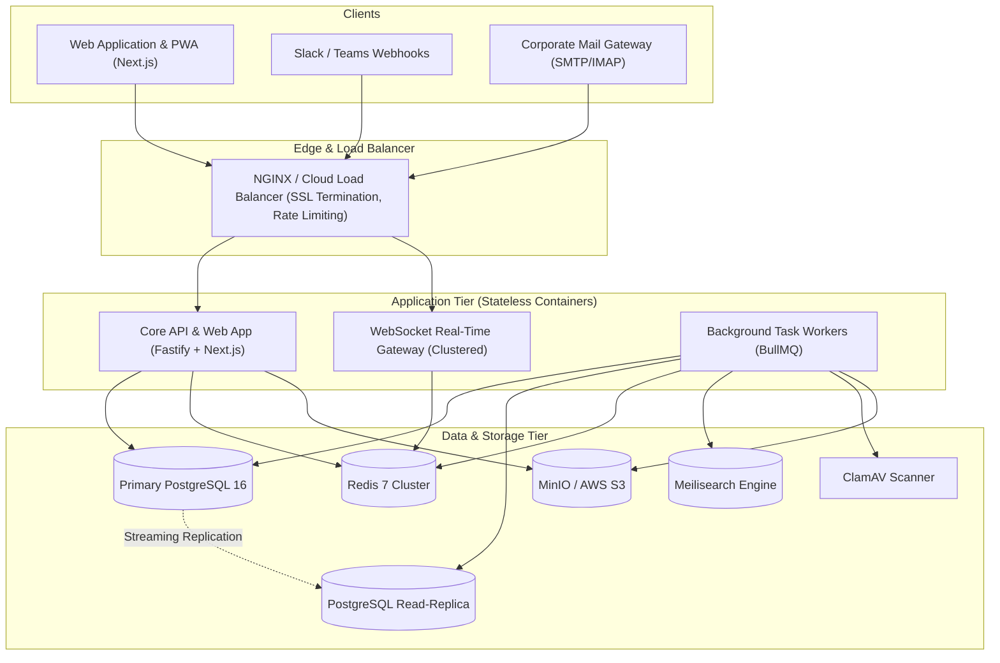

# Phase 3 — Technology Stack Recommendation

This document provides a rigorous, requirement-driven evaluation of the technology stack for the unified Ticketing and Task Management Platform, balancing developer velocity, sub-100ms response targets, enterprise maintainability, and infrastructure cost.

---

## 1. Component-by-Component Technology Evaluation

### 1.1 Frontend Framework & Client Architecture
* **Selected Recommendation:** **React 19 + Next.js 15 (App Router) + TypeScript**
* **UI & Component System:** **Tailwind CSS + Shadcn UI (Radix UI Primitives) + Lucide Icons**
* **State Management & Data Synchronization:** **TanStack Query (React Query) + Zustand**
* **Rich Text & Collaborative Editor:** **TipTap (ProseMirror-based with Markdown support)**
* **Why it fits:** 
  * Linear-grade optimistic UI requires granular control over client-side mutation rollbacks and cache updates; TanStack Query excels at this with zero boilerplate.
  * Radix UI / Shadcn provides 100% accessible, unstyled headless primitives (dialogs, dropdowns, popovers, command palette `cmdk`) that allow complete aesthetic customization without bundle bloat.
  * Next.js provides hybrid Server Components (for instant initial page loads of dashboards) and Client Components (for high-velocity interactive boards).
* **Evaluated Alternatives:**
  * *Vue 3 / Nuxt 3:* Excellent reactivity, but the enterprise ecosystem for keyboard-first command palettes and advanced drag-and-drop board primitives is significantly smaller than React's ecosystem.
  * *SvelteKit:* Incredible runtime speed, but enterprise design system libraries and long-term hiring pools are more constrained.

---

### 1.2 Backend Framework & Runtime
* **Selected Recommendation:** **Node.js (LTS) / TypeScript with Fastify (Modular Monolith Architecture)**
* **Contract & Schema Validation:** **Zod + OpenAPI 3.1 (Fastify-Swagger)**
* **Why it fits:**
  * **Unified Type System:** TypeScript across frontend and backend allows 100% shared schema contracts (ticket types, custom field schemas, API request/response types) using Zod.
  * **Performance:** Fastify is 2x–3x faster than Express, has native JSON schema compilation, robust plugin encapsulation for modular boundaries, and native support for asynchronous streams.
  * **Maintainability:** Avoids the multi-language context switching of maintaining a Go/Rust backend and TypeScript frontend for an internal enterprise engineering team.
* **Evaluated Alternatives:**
  * *Go (Golang with Gin / Fiber):* Exceptional raw throughput and minimal memory usage. However, sharing validation logic and DTO schemas with the TypeScript frontend requires complex code-generation pipelines (e.g. Protocol Buffers / gRPC), slowing down sprint iteration velocity.
  * *Python (FastAPI):* Great developer ergonomics, but Python’s asynchronous I/O under high WebSocket connection concurrency requires significantly higher CPU/memory than Node.js or Go.

---

### 1.3 Database & ORM
* **Primary Relational Database:** **PostgreSQL 16**
* **ORM / Database Layer:** **Drizzle ORM**
* **Why it fits:**
  * **PostgreSQL 16:** The gold standard for enterprise data integrity. Native JSONB support with GIN indexing powers our project-scoped custom fields. Supports native Row-Level Security (RLS) for multi-audience isolation, declarative partitioning for historical audit logs, and continuous WAL streaming for disaster recovery.
  * **Drizzle ORM:** Unlike Prisma (which runs a heavy Rust query engine binary that consumes 100MB+ RAM and introduces query latency overhead), Drizzle compiles directly to lean, parameterized SQL queries with zero runtime overhead, sub-millisecond cold starts, and full SQL-like TypeScript inference.
* **Evaluated Alternatives:**
  * *Prisma ORM:* Superior DX initially, but notorious for generating suboptimal SQL with nested relational joins, high memory usage, and poor bulk mutation performance.
  * *MongoDB / Document Store:* Poor fit. Enterprise ticketing requires strict relational integrity (parent-child dependencies, foreign key cascades, transactional audit logging, and joins across users, projects, and permissions).

---

### 1.4 Real-Time & Event Architecture
* **Real-Time Gateway:** **WebSockets (`ws` / Socket.io) clustered via Redis Adapter**
* **In-Memory Cache & Message Broker:** **Redis 7 (Valkey)**
* **Why it fits:**
  * Redis 7 provides dual utility: sub-millisecond ephemeral caching (session bitmasks, live presence avatars) and high-throughput Pub/Sub for broadcasting card moves and comment notifications across clustered backend nodes.
* **Evaluated Alternatives:**
  * *Server-Sent Events (SSE):* Excellent for server-to-client notifications, but does not support full-duplex bi-directional communication required for client typing indicators and live presence heartbeats.

---

### 1.5 Background Workers & Asynchronous Queues
* **Job Queue:** **BullMQ (Redis-backed)**
* **Why it fits:**
  * Powers asynchronous event automations (auto-assignment, SLA breach timers, email ingestion, webhook dispatching, ClamAV antivirus file scanning).
  * Native support for scheduled cron jobs (nightly analytics rollups), exponential retry backoffs, and Dead-Letter Queues (DLQs).
* **Evaluated Alternatives:**
  * *Temporal.io:* Outstanding for multi-day human-in-the-loop workflows, but introduces substantial infrastructure operational overhead (separate cluster, Cassandra/Postgres storage) unnecessary at this scale.

---

### 1.6 Search Engine
* **Dedicated Search Service:** **Meilisearch**
* **Why it fits:**
  * Rust-based, blazing fast (<20ms response time), typo-tolerant search-as-you-type out of the box. Single Docker container, requires ~200MB RAM compared to Elasticsearch’s 2GB–4GB JVM heap requirements.
* **Evaluated Alternatives:**
  * *Elasticsearch / OpenSearch:* Heavy enterprise footprint; operational nightmare for a mid-to-large internal enterprise deployment unless ingesting terabytes of raw logs daily.

---

### 1.7 File Storage & Antivirus
* **Object Storage:** **S3-Compatible Object Store (AWS S3 or self-hosted MinIO)**
* **Malware Scanner:** **ClamAV (Containerized microservice)**
* **Upload Strategy:** Direct browser-to-storage upload via Presigned PUT URLs.

---

### 1.8 Enterprise Authentication & Directory Sync
* **Identity Protocol:** **OpenID Connect (OIDC) & SAML 2.0 (via Keycloak, Auth0, or WorkOS)**
* **User Lifecycle:** **SCIM 2.0 (System for Cross-domain Identity Management)** for automatic onboarding and offboarding from corporate IdP (Okta, Microsoft Entra ID, Google Workspace).

---

## 2. Architecture Comparison: Option 1 vs. Option 2

### Option 1: Cost-Effective & High-Maintainability Modular Monolith (RECOMMENDED)

* **Target Workload:** 1,000 to 10,000 internal users; 10k–50k tickets/month; 300–800 concurrent sessions.
* **Infrastructure Footprint:** 6–8 lightweight Docker containers (2x API, 2x WebSocket, 2x Workers, 1x Meilisearch, 1x Redis, 1x MinIO).
* **Cost:** Very low (\$150 – \$400/month on cloud VMs or runs seamlessly on existing on-prem Kubernetes clusters).
* **Maintainability:** Single TypeScript codebase, unified CI/CD pipeline, shared models, zero distributed transaction overhead.

---

### Option 2: Distributed Event-Driven Microservices (For 50k+ Users & Global Scale)

* **Architecture:** 5 separate microservices (`Identity & IAM Service`, `Ticket & Workflow Service`, `ITSM & SLA Engine`, `Notification & Integration Hub`, `Analytics & Reporting Service`) communicating via Apache Kafka and gRPC.
* **Trade-Off Analysis:**
  * *Advantages:* Independent team deployments, isolated database scaling per domain.
  * *Disadvantages:* Massively increased infrastructure cost (\$2,500+/month), complex distributed tracing (OpenTelemetry), eventual consistency challenges, cross-service data joins, and high operational overhead.
* **Architectural Verdict:** **Avoid for current requirements.** Option 1 provides identical sub-100ms end-user performance with 1/5th the operational complexity. Option 1's modular domain structure allows carving out microservices later if organizational scale demands it.
