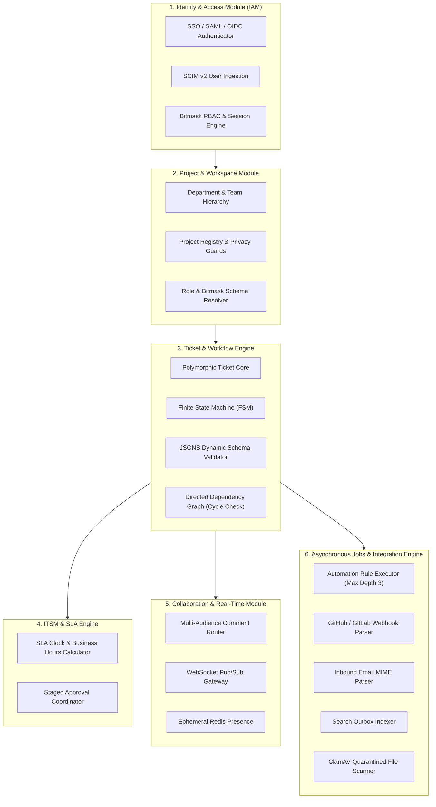
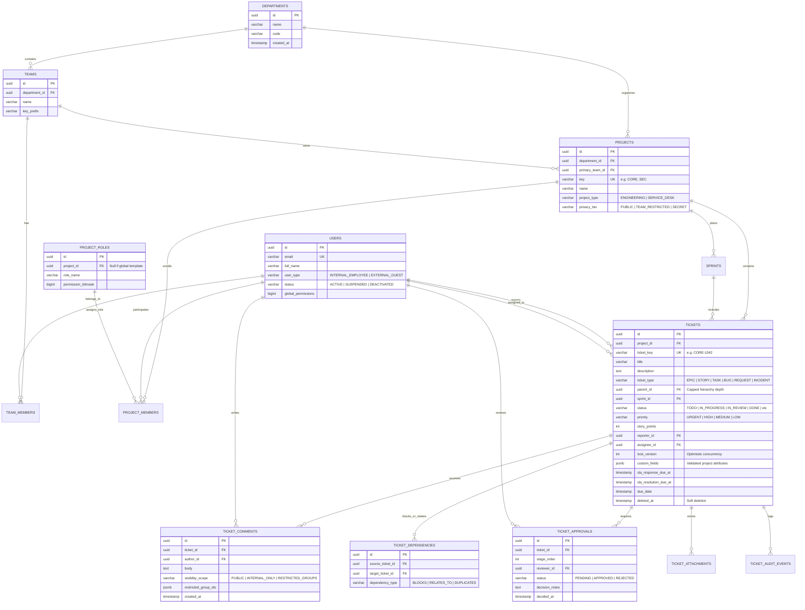
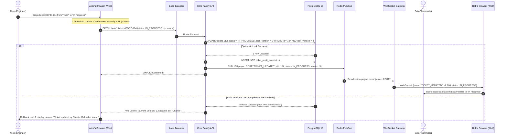
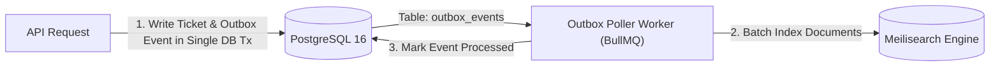

# Phase 4 — System Architecture & Component Design

This document details the high-level system architecture, module boundaries, database entity relationships, authorization flows, and real-time event distribution for the platform.

---

## 1. High-Level Component & Module Boundaries

The backend is architected as a **High-Performance Modular Monolith** in TypeScript/Fastify. Each domain is strictly isolated with clear internal public contracts, enabling zero-friction refactoring and future extraction into independent microservices if required.

---

## 2. Database Architecture: Entity-Relationship Diagram (ERD)

---

## 3. Real-Time Event & Synchronization Architecture

To power **Linear-like sub-50ms optimistic UI** without client-server desynchronization, card movements and comment posts use an event-driven broadcast model:

---

## 4. Asynchronous Outbox & Search Indexing Pipeline

This guarantees **zero lost search index updates** even if the background worker or search container crashes.
