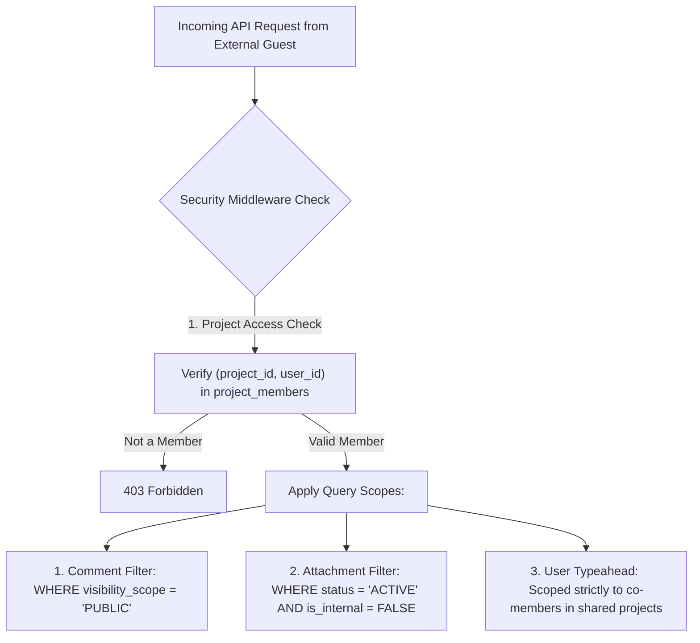
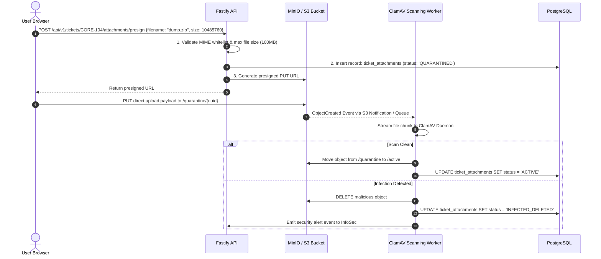

# Phase 6 — Security Architecture & Hardening Guide

This document details the enterprise security architecture, authorization enforcement, guest sandboxing, upload sanitization, and OWASP Top 10 mitigations.

---

## 1. 64-Bit Bitmask Permission Architecture

To eliminate the recursive table joins that slow down Jira, permissions are modeled as atomic bit flags in a 64-bit integer.

### 1.1 Permission Bit Definitions
```typescript
export const Permissions = {
  // Global / System (Bits 0-7)
  ORG_ADMIN:             1n << 0n, // 1
  PROJECT_CREATE:        1n << 1n, // 2
  USER_INVITE:           1n << 2n, // 4

  // Project Level (Bits 8-19)
  PROJECT_VIEW:          1n << 8n,  // 256
  PROJECT_EDIT:          1n << 9n,  // 512
  PROJECT_DELETE:        1n << 10n, // 1024
  PROJECT_ADMIN:         1n << 11n, // 2048

  // Ticket Operations (Bits 20-35)
  TICKET_VIEW:           1n << 20n, // 1048576
  TICKET_CREATE:         1n << 21n, // 2097152
  TICKET_EDIT:           1n << 22n, // 4194304
  TICKET_DELETE:         1n << 23n, // 8388608
  TICKET_ASSIGN:         1n << 24n, // 16777216
  TICKET_TRANSITION:     1n << 25n, // 33554432
  TICKET_ATTACH:         1n << 26n, // 67108864

  // Collaboration & ITSM (Bits 36-47)
  COMMENT_VIEW_PUBLIC:   1n << 36n,
  COMMENT_CREATE_PUBLIC: 1n << 37n,
  COMMENT_VIEW_INTERNAL: 1n << 38n, // Internal notes
  COMMENT_CREATE_INTERNAL:1n << 39n,
  APPROVAL_REVIEW:       1n << 40n,
  SLA_OVERRIDE:          1n << 41n,
} as const;
```

### 1.2 Sub-Millisecond Authorization Check
```typescript
export function hasPermission(userBitmask: bigint, requiredPermission: bigint): boolean {
  // Organization Admin bypasses all checks
  if ((userBitmask & Permissions.ORG_ADMIN) === Permissions.ORG_ADMIN) {
    return true;
  }
  return (userBitmask & requiredPermission) === requiredPermission;
}
```

---

## 2. External Guest Sandboxing & Privacy Boundaries

External contractors and agency partners must never see other internal projects, employees, or internal notes.



---

## 3. File Upload Quarantine Pipeline & Antivirus

To prevent malware ingestion without bottlenecking application server memory:



---

## 4. Outbound Webhook SSRF Hardening

Custom webhook URLs configured by project admins present serious **Server-Side Request Forgery (SSRF)** risks.
The outbound webhook dispatcher enforces:
1. **Protocol Restriction:** Only `https://` permitted in production.
2. **DNS Resolution & IP Validation:** Resolves hostname to IP before socket connection. If the IP matches:
   * Loopback (`127.0.0.0/8`)
   * Private Networks (`10.0.0.0/8`, `172.16.0.0/12`, `192.168.0.0/16`)
   * Link-Local & Cloud Metadata (`169.254.0.0/16`, `169.254.169.254`)
   The request is immediately aborted before TCP handshake.
3. **DNS Pinning:** Connects directly to the validated IP to prevent DNS Rebinding attacks between validation and request.

---

## 5. OWASP Top 10 Mitigation Matrix

| OWASP Risk | Platform Vulnerability Vector | Hardened Architectural Defense |
| :--- | :--- | :--- |
| **A01: Broken Access Control** | User accesses tickets from other restricted/secret projects. | 64-bit Bitmask validation in Fastify preHandler hook + PostgreSQL Row-Level Security (RLS) enforcement on all ticket and comment queries. |
| **A02: Cryptographic Failures** | Token theft, data leaks in transit/at rest. | TLS 1.3 only, AES-256 database column encryption for OAuth secrets, HMAC-SHA256 signature verification on webhooks, bcrypt (cost factor 12) for local service accounts. |
| **A03: Injection** | SQL injection via dynamic custom field filters. | Drizzle ORM strictly compiles parameterized SQL. Dynamic JSONB custom field queries use PostgreSQL `@>` containment and `->>` operators with strongly typed Zod input validation schemas. |
| **A04: Insecure Design** | Unlimited recursion in automated workflow rules. | Enforced execution depth limit ($depth \le 3$) on the BullMQ rule engine; cycle detection algorithm on ticket dependencies. |
| **A05: Security Misconfiguration** | Default admin passwords, exposed debug logs. | Zero default credentials; secrets managed via HashiCorp Vault / AWS Secrets Manager; structured JSON logging (Pino) automatically redacting authorization headers, passwords, and tokens. |
| **A07: Identification & Auth Failures** | Brute force login, session hijacking. | Corporate SSO (SAML/OIDC) integration; Redis Token Bucket rate limiting (5 attempts/min on auth endpoints); sliding-window JWT access tokens (15 min expiry) with Redis-backed refresh token rotation. |
