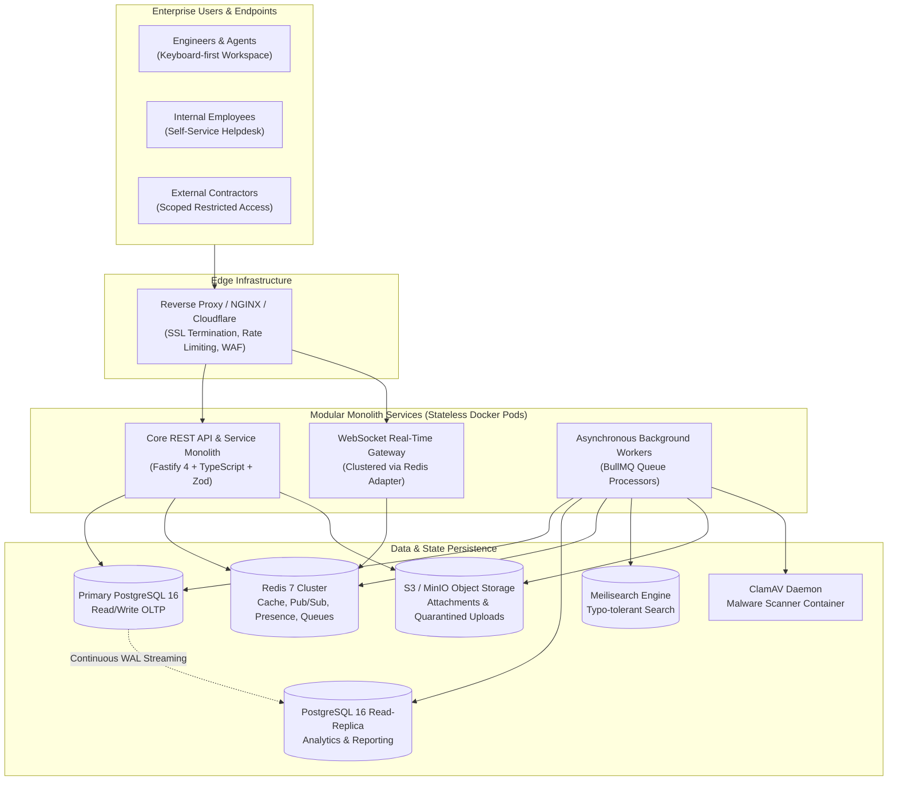
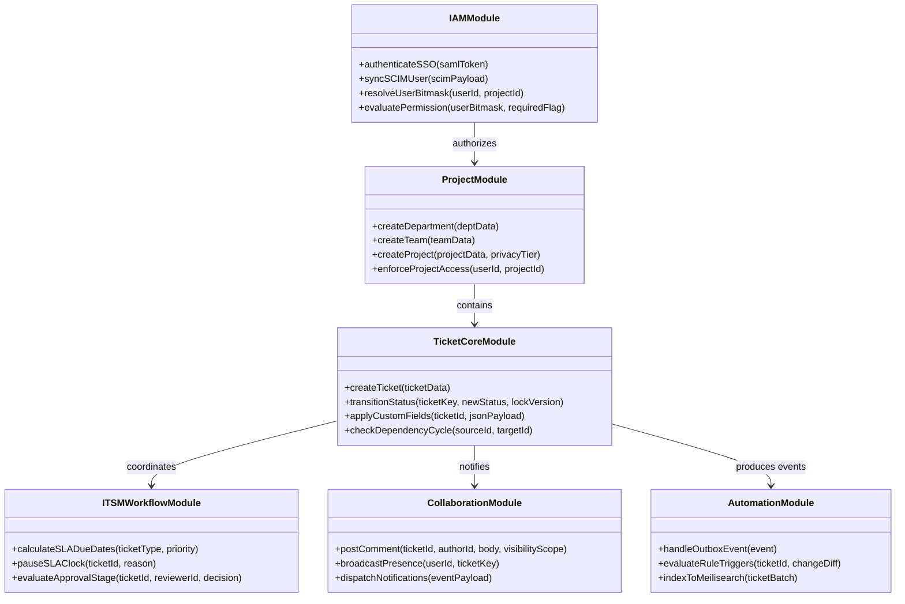

# Phase 8 — Master Technical Blueprint & Software Requirements Specification (SRS)

## Executive Summary & Architectural Contract

* **Product Name:** Enterprise Unified Ticketing & Task Management Platform (Internal Code: **CoreTrack**)
* **Deployment Topology:** Single-Tenant Internal Enterprise System (On-Premises Kubernetes or Dedicated Private Cloud)
* **Scale Capacity:** 1,000 to 10,000 internal users | 200–1,500 active power users | 300–800 concurrent sessions | 10k–50k tickets/month
* **Reliability SLA:** 99.9% Uptime | RPO < 15 minutes | RTO < 1 hour
* **Performance Benchmark:** Sub-50ms optimistic UI interactions | p95 API response < 150ms | Sub-20ms search queries

---

## 1. System Architecture Overview

---

## 2. Core Functional Modules & Boundaries

---

## 3. Technology Stack Reference Sheet

| Domain | Technology Selected | Rationale & Enterprise Fit |
| :--- | :--- | :--- |
| **Frontend Framework** | **React 19 + Next.js 15 (App Router)** | Best-in-class optimistic UI handling, SSR dashboard speed, industry-standard hiring pool. |
| **Styling & Components** | **Tailwind CSS + Shadcn UI (Radix)** | 100% accessible, unstyled headless primitives; zero runtime CSS overhead; full keyboard support. |
| **Client State / Cache** | **TanStack Query v5 + Zustand** | Optimistic cache updates, query invalidation, and sub-100ms local mutation rollbacks. |
| **Backend Runtime** | **Node.js LTS (TypeScript) + Fastify** | 3x faster than Express, compiled JSON schema validation, shared types with frontend. |
| **Primary Database** | **PostgreSQL 16** | Relational integrity, JSONB GIN indexing for custom fields, Row-Level Security, WAL replication. |
| **ORM / Query Layer** | **Drizzle ORM** | Direct SQL-like TypeScript query compilation with zero query-engine overhead or cold-start penalty. |
| **In-Memory Store** | **Redis 7 (Valkey)** | Session caching, 64-bit bitmask caching, ephemeral presence tracking, and WebSocket Pub/Sub. |
| **Task Queue** | **BullMQ** | Reliable Redis-backed asynchronous job processing with dead-letter queues and retry backoffs. |
| **Search Engine** | **Meilisearch** | Typo-tolerant search-as-you-type in <20ms, lightweight single-container footprint (200MB RAM). |
| **Object Storage** | **MinIO (Self-hosted) / AWS S3** | S3-compatible, direct client presigned URL uploads with zero memory buffering on app nodes. |
| **File Antivirus** | **Containerized ClamAV** | Asynchronous malware scanning of quarantined attachments before publishing. |
| **Auth & Identity** | **OIDC / SAML 2.0 + SCIM 2.0** | Native integration with Okta, Microsoft Entra ID (Azure AD), Google Workspace. |
| **Monitoring & Tracing**| **OpenTelemetry + Prometheus + Grafana** | Vendor-neutral distributed tracing, metric dashboards, and alert managers. |

---

## 4. Key Architectural Decisions Summary

1. **Deployment Architecture:** Single-tenant internal deployment. Avoids multi-tenant data leaks and billing complexity, focusing purely on deep departmental and team hierarchies.
2. **Two-Tier Workflow Engine:** High-velocity linear finite state machine for engineering delivery (sub-100ms, no administrative overhead) paired with a robust ITSM service desk engine (multi-tier approvals, SLA countdowns, requester privacy).
3. **Optimistic Concurrency & Live Presence:** Eliminates silent edit overwrites via incremental `lock_version` checking ($409\text{ Conflict}$) paired with real-time WebSocket presence avatars.
4. **Pre-computed 64-bit Bitmask RBAC:** Compresses 30+ granular permissions into a 64-bit integer cached in Redis, enabling $O(1)$ bitwise authorization checks without recursive SQL permission joins.
5. **Capped 4-Level Structural Hierarchy:** `Initiative` $\rightarrow$ `Epic` $\rightarrow$ `Task/Bug/Request` $\rightarrow$ `Subtask`. Prevents recursive CTE locking and ensures deterministic board swimlanes.
6. **Transactional Outbox Pipeline:** Guarantees zero lost events between PostgreSQL, Meilisearch, and WebSocket broadcast channels even during system restarts.
7. **Read-Replica Analytics Offload:** Eliminates database lockups by routing all heavy historical aggregations to asynchronous read-replicas with pre-computed hourly rollup snapshots.
